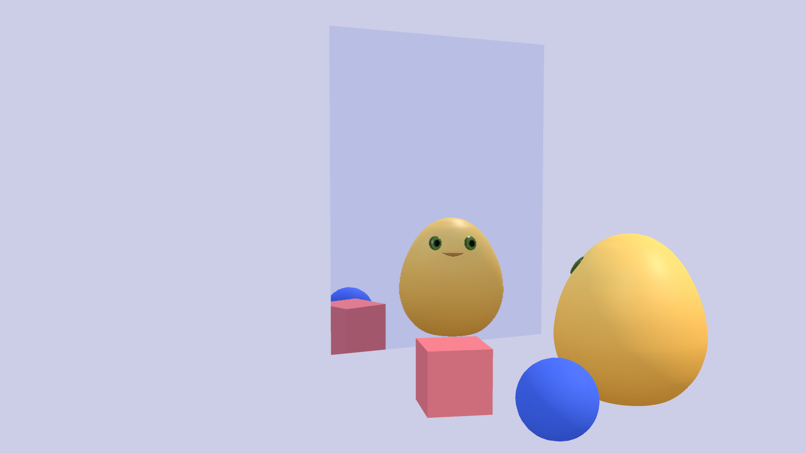
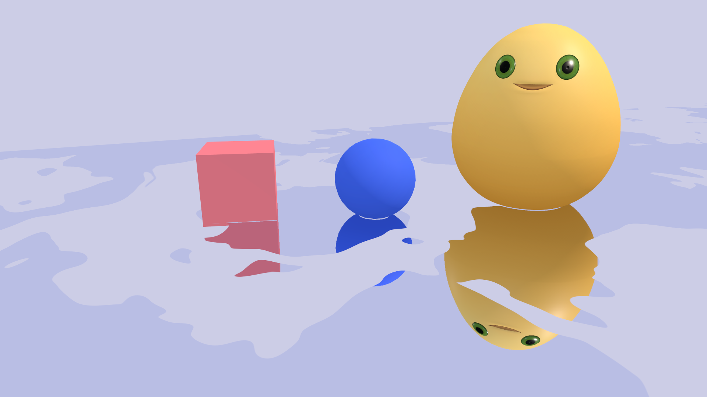

# Multi-Functional Mirror

A planar reflection toolkit for Unity. Includes upright square and round mirrors, a procedural puddle, and material controls for distortion, scratches, water stains, and ripples.

| Render pipeline | Tested Unity editor | Pipeline package |
| --- | --- | --- |
| Built-in | 2022.3.51f1 | Built-in |
| URP | 2023.2.20f1 | 16.0.6 |
| HDRP | 2023.2.20f1 | 16.0.6 |

## Screenshots

Upright mirror, captured in Unity 2022.3 with the Built-in render pipeline.

Procedural puddle, captured in Unity 2022.3 with the Built-in render pipeline.

## Install

1. Open a Unity project configured for one of the pipelines above.
2. Download its matching `.unitypackage` from [Releases](https://github.com/DonkeyDungeon/Multi-Functional-Mirror/releases), then use **Assets > Import Package > Custom Package**.
3. Open `Assets/DonkeyDungeon/PlanarMirror/Samples/<pipeline>/MirrorShowcase.unity` or drag a prefab from the matching `Prefabs/<pipeline>` folder. A mirror reflects from its local +Z side. The puddle prefab already faces up.

The pipeline folder names are `Builtin`, `URP`, and `HDRP`. For example, the Built-in sample scene is `Assets/DonkeyDungeon/PlanarMirror/Samples/Builtin/MirrorShowcase.unity`.

Choose one pipeline package per project. Toolkit mirror surfaces are excluded from reflection captures. See the [tested configurations and limitations](Assets/DonkeyDungeon/PlanarMirror/Documentation/Compatibility.md).

## License

The [MIT License](LICENSE) covers the project source code, shaders, examples, and original included textures. Unity render pipeline packages are installed separately through Unity Package Manager and retain their own terms.
